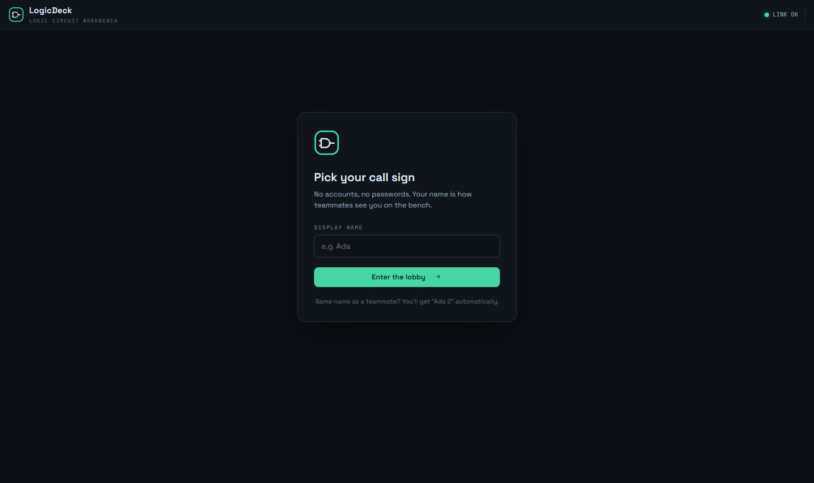
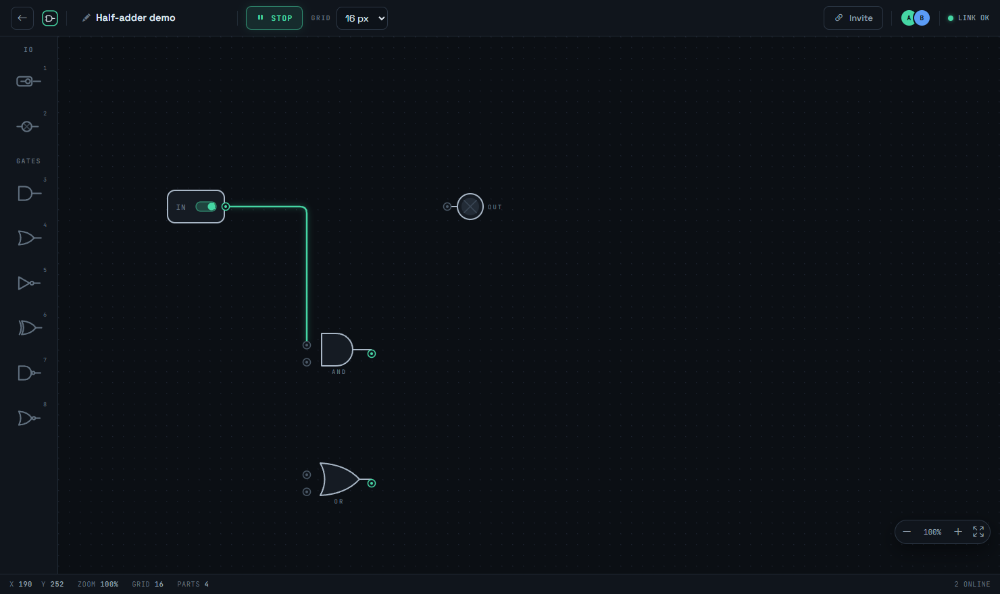
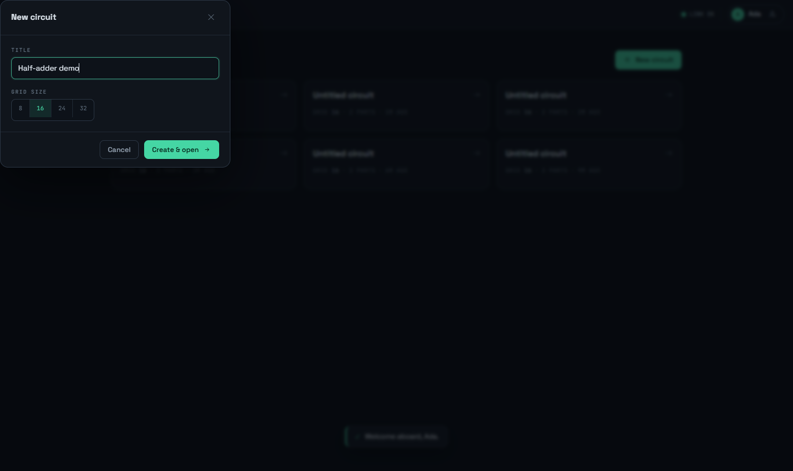
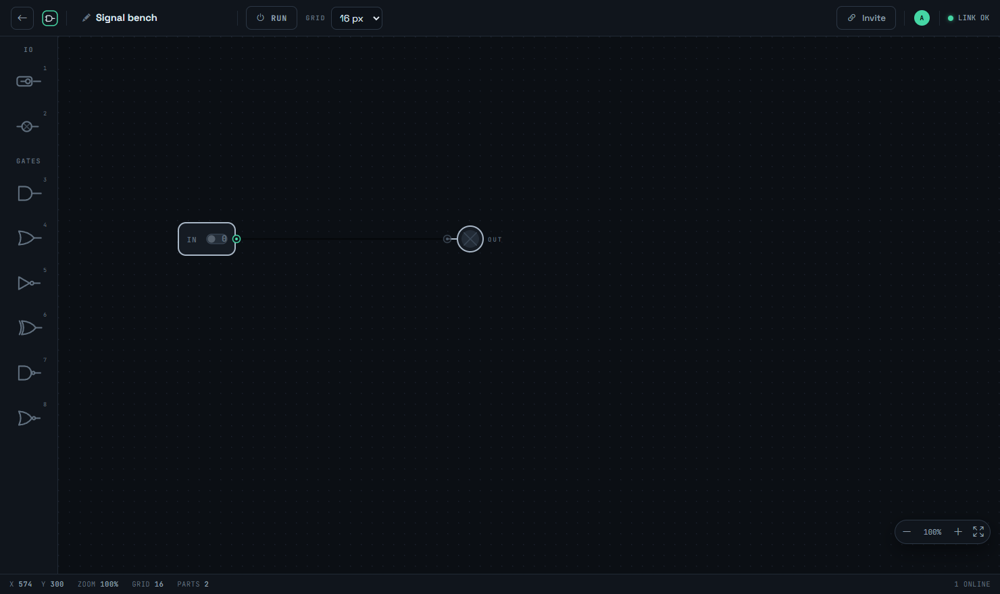

# LogicDeck — realtime collaborative logic-circuit workbench

A multi-user dashboard for small local teams to **draw logic circuits together in real time**.
Users join with just a display name (no registration, no passwords),
create circuit rooms or join existing ones, place gates and wires on a shared
canvas, and run a **live logic simulation** that propagates signals to every
connected client instantly.

Built with **ASP.NET Core 9 + SignalR** on the backend and **JointJS**
(diagramming library) on the frontend.




## Features

- **Name-only identity** — pick a call sign, no accounts. Duplicate names are
  deduplicated automatically (`John`, `John 2`, `John 3`, …), each with a
  unique color used across avatars and presence cursors.
- **Live circuit lobby** — see every open circuit (title, members, grid size,
  running state) update without page reloads; create new ones with a title and
  grid size.
- **Collaborative canvas** — inputs (toggle switches), outputs (lamps),
  a free-running **CLK clock** (toggles while RUN is on), momentary **push
  buttons**, **7-segment hex displays** (wire four switches as a BCD nibble —
  0 to F), a **D flip-flop** (edge-clocked memory: D in, Q/Q̄ out — build
  counters and shift registers), AND / OR / NOT / XOR / XNOR / NAND / NOR
  gates, orthogonal auto-routed wires with snapping, pan/zoom, selection,
  delete; click-or-drag placement, keyboard shortcuts (`0`–`9`, `B`, `D`, `F`),
  grid-snapped drops.
- **Reusable custom ICs** — select a group of combinational gates, choose
  **Package IC**, label its boundary pins, and place the saved block from the
  custom IC palette.
- **Live logic simulation** — press RUN and flip input switches: signals
  propagate through gates to all clients in real time. Clocks tick at 2 Hz
  while the bench is running. High wires glow green,
  low wires stay dim, oscillating feedback loops are flagged amber.
- **Truth table** — with switches and lamps wired up, **Truth table** enumerates
  every input combination and shows each lamp's value in a modal (up to 8
  switches), ready to copy or download as CSV — great for checking a design.
- **Presence** — remote users' colored cursors with name tags glide across
  your canvas; see who is in the room at all times.
- **Durable without a database** — every circuit auto-saves to a plain JSON file
  on the server (`App_Data/circuits/`) within ~2 s of a change and is restored
  when the server restarts. Only input-switch positions carry over; RUN, member
  lists and live clock/flop levels reset. No accounts, no migrations, no DB.
- **Server-authoritative sync** — the server validates every op (pin rules,
  one-wire-per-input, no self-loops), broadcasts to room groups, and sends
  full snapshots to late joiners and reconnects. Rooms close after 10 idle
  minutes (their saved file is removed too).

## Quick start

Requirements: [.NET 9 SDK](https://dotnet.microsoft.com/download) only — no
Node.js, no database, no build step (all client libraries are vendored).

```bash
dotnet run --project LogicDeck.Web
# open http://localhost:5050
```

For a genuine two-machine session on a LAN:

```bash
dotnet run --project LogicDeck.Web --urls http://0.0.0.0:5050
# teammates open http://<your-lan-ip>:5050/circuit/<room-id>
```

Run the test suite (unit + live two-client SignalR end-to-end tests):

```bash
dotnet test
```

## How it works

```
Browser ──┐
Browser ──┼── WebSocket ──► CollabHub ──► CircuitStore (in-memory, per-room locks)
Browser ──┘                          lobby:{all} + room:{id} SignalR groups
                                          │ dirty rooms (2 s tick + shutdown)
                                          ▼
                                   App_Data/circuits/<id>.json
```

- `LogicDeck.Web/Hubs/CollabHub.cs` — typed SignalR hub: lobby ops
  (`JoinLobby`, `CreateRoom`, `FetchRooms`) and room ops (`EnterRoom`,
  `AddNode`, `MoveNode`, `DeleteNodes`, `AddWire`, `RemoveWire`,
  `ToggleInput`, `SetRunning`, `ComputeTruthTable`, `SetGridSize`, `RenameRoom`,
  `SendCursor`).
- `LogicDeck.Web/Core/` — `CircuitStore` (ephemeral rooms + idle sweeper),
  `CircuitPersistence` (versioned JSON files), `LobbyService` (name suffixes +
  palette colors + reconnect grace), `Simulator` (fixed-point boolean evaluation
  with oscillation detection).
- `LogicDeck.Web/*.cs` — `Sweeper`, `ClockTicker` and `PersistenceService`
  background services.
- `LogicDeck.Web/wwwroot/js/` — zero-build ES modules: JointJS canvas
  (`canvas/`), SignalR glue + pages (`pages/`, `core/`).
- `LogicDeck.Tests/` — xUnit: gate truth tables, half-adder, SR-latch and
  oscillator cases, name-registry rules, store GC, plus `EndToEndTests` that
  spin up a real server and drive two SignalR clients through naming,
  live propagation, wire validation, simulation and cascade deletes.

## Screenshots

| Lobby — name gate | New circuit |
|---|---|
|  |  |

| Editor — wired bench | Editor — run mode, signal high |
|---|---|
|  |  |

## Libraries used

- [@joint/core 3.7.7](https://github.com/clientio/joint) (MPL-2.0) — diagram canvas, gates, wires
- [ASP.NET Core SignalR](https://dotnet.microsoft.com/apps/aspnet/signalr) — realtime sync
- [Bootstrap Icons](https://icons.getbootstrap.com/) — UI iconography
- [jQuery](https://jquery.com/) / [Lodash](https://lodash.com/) / [Backbone.js](https://backbonejs.org/) — JointJS dependencies
- [Space Grotesk](https://fonts.google.com/specimen/Space+Grotesk) / [JetBrains Mono](https://www.jetbrains.com/lp/mono/) — typography (all vendored, works offline)
